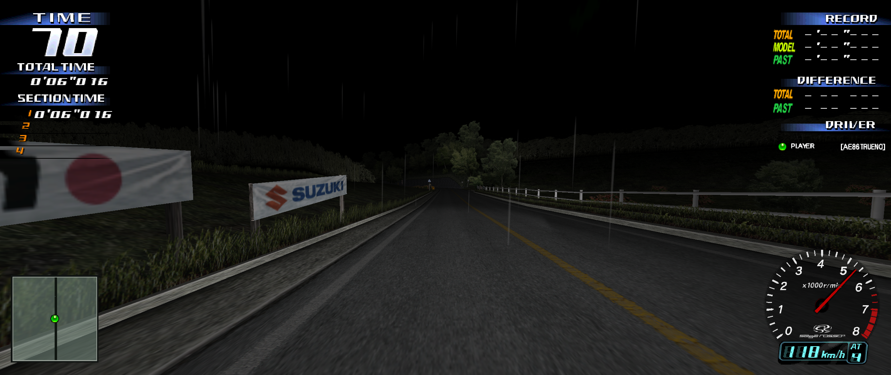

# Initial D Arcade Stage 3 Reimagined

A fan-made Initial D Arcade Stage 3 project for Windows, with Unity rendering and a native C++ gameplay core.
JOIN DISCORD: [https://discord.gg/mJCZ5AvBb](https://discord.gg/fUZySYrPss)

**[Download the game](https://github.com/distilledorion-sketch/Initial-D-Arcade-Stage-3-Reimagined/releases/latest)** · **[Community leaderboard](https://initial-d-leaderboard.initial-d-community-leaderboard.workers.dev)** · **[Report a bug](https://github.com/distilledorion-sketch/Initial-D-Arcade-Stage-3-Reimagined/issues/new/choose)** · **[Changelog](CHANGELOG.md)**

## Play

1. Download **Initial-D-Setup-0.3.95.62.zip** from **Releases**. Extract it and run **Install Initial D Arcade Stage 3 Reimagined.exe**.
2. Choose a writable game folder. Supply either the English GDS-0033 CHD with `317-0384-COM.pic` or `initdv3e.zip`, or the Japanese Rev C GDS-0032C CHD with `317-0379-jpn.pic` or `initdv3j.zip`. One matching pair supplies the complete regional game. **Options → Gameplay** lets you change the custom menu language independently and switch ROM regions on restart.
3. Launch **Initial D Arcade Stage 3 Reimagined.exe**. Extract optional tracks into `Mods/Maps` beside the game, then open **Mods** in Time Attack to select one. [Download mod maps on GameBanana](https://gamebanana.com/games/26479)

**Windows update .62** can also be installed through the in-game updater. Setup and the updater use the same complete Windows ZIP. Keep older copies of the game closed during the first launch so setup can migrate your previous player files into `UserData`. Keep this folder when moving or backing up the game.

If an earlier update opened with a blank card or default settings, choose your previous installation when prompted. You can also open **Recover Saves and Settings.cmd** in the game folder and select the old folder on any drive. Restore includes card progress, controls, local records, HUD artwork, tachometers and ornaments. Replaced data is backed up in `UserData/Save recovery backups`.

For manual setup, extract the Windows x64 ZIP to a writable folder and open `InitialDUnity.exe` once. After setup, use **Initial D Arcade Stage 3 Reimagined.exe**. See the [changelog](CHANGELOG.md) for this update.

Optional [Discord Rich Presence](docs/discord/README.md) shows **Initial D Arcade Stage 3**, the game logo, and your current race, menu, or replay activity. Toggle it under **Options > Gameplay > Discord Rich Presence**.

## Features

- GitHub update checks with small changed-file patches, full repair, installation and restart.
- Time Attack, Legend of the Streets, Bunta Challenge and online battles.
- Original course and car selections, plus Hakone, Sadamine, Enna Skyline, Momiji Line, Tsubaki Line, Gunsai, Odawara and the longer Special Stage layouts of Myogi and Usui.
- Special Stage courses support Time Attack rankings, replays and online battles, with downhill/uphill and dry/wet options at night.
- Day, night and weather conditions supported by each course.
- Controller, keyboard and supported wheel input. Controller vibration uses original road, engine/speed, contact and gear-change calculations, with an on/off switch and strength slider under Options > Steering & Wheel (default: on, 50%). Supported wheels also use the original steering-force and damping calculations.
- Personal saves, progression, tuning and a Full Tune option.
- Community Time Attack rankings with time-only submissions.
- Local replay library, camera controls, online opponent POV and replay engine audio.
- Custom race music: put MP3, OGG and WAV files in `Custom Music` beside the game, or import them in Select BGM. Select BGM also lets you delete custom tracks.
- Graphics presets, lower output resolutions and adjustable effects/scenery detail.

This project is a work in progress. Rendering fidelity, performance and multiplayer behavior continue to receive fixes; hardware and course combinations vary.

## Records and replays

While connected, in-game rankings combine the selected save's personal bests with the current community leaderboard. With Community Times switched off, the in-game leaderboard shows local finishes and saved bests from every slot on this installation, including legacy cards. Open Options → Online → Local Leaderboard to browse them. The race’s personal-best target still belongs to the selected card. Matching published personal times appear once.

Season 2 accepts new Time Attacks from supported builds. Previous-season local records and ghosts are reset; older queued runs cannot be uploaded retrospectively. Cars, tuning, battle progress and ordinary replay recordings are preserved. Replay recording is optional and is not required to post a time. Submitted times and client build declarations are not authoritative anti-cheat verification.

Personal Time Attack, Online Battle and Legend recordings stay on the player's PC. Community replay uploads and downloads are disabled. Options > Replays opens the local library and recording controls.

## Build and contribute

See **[BUILDING.md](BUILDING.md)** for the development setup and **[CONTRIBUTING.md](CONTRIBUTING.md)** for bug reports and changes.

The repository includes the runtime assets in `Native/data` and `RuntimeAssets`, along with the Unity project, native source, tests and leaderboard service source. The checkout is several gigabytes. Personal saves, uploaded recordings, credentials and local editor/build caches are excluded.

| Directory | Contents |
|---|---|
| `Assets` | Unity scripts, shaders, resources, scenes and native plugins |
| `Native/src` | Native gameplay, asset loading, menus, audio and renderer bridge |
| `Native/data` | Original runtime data used by the game |
| `RuntimeAssets` | Nine additional course packs, including four Special Stage layouts |
| `Native/tests` | Native regression tests and isolated gameplay fixtures |
| `Tools` | Local build, staging and asset utilities |
| `Leaderboard` | Community leaderboard service, migrations and tests |

This is an unofficial fan project and is not affiliated with or endorsed by SEGA or the Initial D rights holders. Existing third-party notices and licenses remain applicable; no blanket license is granted over third-party game content.
